<picture>
  <source media="(prefers-color-scheme: dark)" srcset="brand/banner-dark.svg">
  
</picture>

[](https://github.com/abiodunosagie/wayword/actions/workflows/ci.yml)


Wayword is an open-source React Native app for people who have moved somewhere new and want to
learn the language from their own days, not from a textbook. Photograph a street sign, a menu, a
letter from the council or the label on a jar. Claude reads it, says what it means, explains the
parts that are hard to guess, and picks out the words worth keeping. Those words become cards,
each one tied to the photo it came from, and you practise them until they stick.

## What it does

| Tab | What you do | What Claude does |
| --- | --- | --- |
| **Snap** | Take or pick a photo of a sign, a menu, a letter or a label | Reads the text exactly, translates it, explains what it means for you, and picks three to six words worth keeping, each with meaning, pronunciation, an example and a note (vision + structured output) |
| **Words** | Search everything you kept; open a word to hear it, see the photo it came from, and ask **Why?** | Answers questions about the word (grammar, how formal it is, what a local would say), streamed as it writes |
| **Practise** | Recall the word, show the answer, say how well you knew it | Nothing: SM-2 spaced repetition runs on the phone, fully offline. Each button shows when the card comes back |
| **Talk** | Rehearse a real situation: ordering from the menu you snapped, calling the landlord, the pharmacy | Plays the other person in the language you are learning, keeps it at your level, gives your line back said naturally, and suggests new words you can keep (structured output per turn) |
| **This week** | Read a short story | Writes it at your level from the words you kept in the last seven days, with each paragraph's meaning one tap away |

Every card keeps the photo it came from. "Farmácia de serviço" is easier to remember when you can
see the green cross on your own street. Any of 33 languages can be the one you speak or the one
you learn, at three levels. The phone reads words, examples and stories aloud in the right voice.

## How it is built

```
Expo app (React Native)                Supabase                               Anthropic API
  Expo Router, native stack + tabs       Edge function "wayword"                Claude Sonnet 5.5
  cards, photos, talks, stories          1. body size, read with a byte cap
    in SQLite on the phone               2. signed-in user (auth.getUser)
  practice scheduled offline (SM-2)      3. typed fields only; the server
  session encrypted (AES-256, key in        builds every prompt
    Keychain / Keystore)                 4. per-user, per-network and project
  holds NO API key                          limits in one locked SQL call
                                         5. call Claude, log what it spent
```

- **The Claude key never ships in the app.** The app sends fields (a photo, a word, the turns of a
  talk), never a system prompt or raw messages, so a modified app cannot change how Claude behaves.
  Text from photos is passed to Claude as material, never as instructions.
- **Limits that hold under bursts.** Requests, tokens per user, per network (hashed IP) and per day
  for the whole project are checked and recorded in one locked database call. Usage is logged even
  when the app disconnects mid-answer.
- **Your words stay on your phone.** Cards, photos, practice, talks and stories live in SQLite and
  the app's own folder, kept apart per account. Deleting the account deletes it on the server and
  everything it kept on the phone.
- **Native where it counts.** Native stack headers with large titles, native tabs (liquid glass on
  iOS 26, Material on Android), SF Symbols and Material Symbols, the platform's own menu pickers
  from `@expo/ui`, sheets for Account. Light and dark mode throughout.

### Claude API features used

| Feature | Where |
| --- | --- |
| Vision | Snap reads the photo |
| Structured output (JSON schema) | Snap, Talk turns and stories come back in exact shapes |
| Streaming | Why? answers appear as Claude writes |
| Server-side refusal fallback | Every request (`server-side-fallback-2026-07-01`) |
| Effort control | Medium for reading photos, low for the rest |

## Run it

The app runs in **Expo Go**: every module it uses ships inside it, so no native build is needed.

```bash
npm install
cp .env.example .env.local   # your Supabase URL and publishable key
npx expo start               # then press i for the iOS Simulator or a for Android
npm run typecheck && npm run lint && npm test
```

### Your own backend

```bash
supabase link --project-ref YOUR-PROJECT
supabase db push --linked --include-all     # the request log and the limits function
supabase config push                        # auth settings (8 character passwords)
supabase secrets set ANTHROPIC_API_KEY=...  # never in the app
supabase functions deploy wayword && supabase functions deploy delete-account
cd supabase/functions/wayword && deno test  # 17 tests: validation, prompts and the handler
```

## Brand

The mark is a tag, the kind you tie to a thing to say what it is: the marigold dot is where it
is tied to the world, the two lines are the word and what it means. Cobalt and marigold on white,
sky and marigold on near-black for dark mode. Every file (icon, splash, lockups, the animated
banner above and the social preview) is built by `python3 brand/generate.py`; see
[brand/BRAND.md](brand/BRAND.md).

## Licence

MIT. See [LICENSE](LICENSE). The bundled font, Schibsted Grotesk, is under the SIL Open Font
License ([brand/fonts/OFL.txt](brand/fonts/OFL.txt)).
